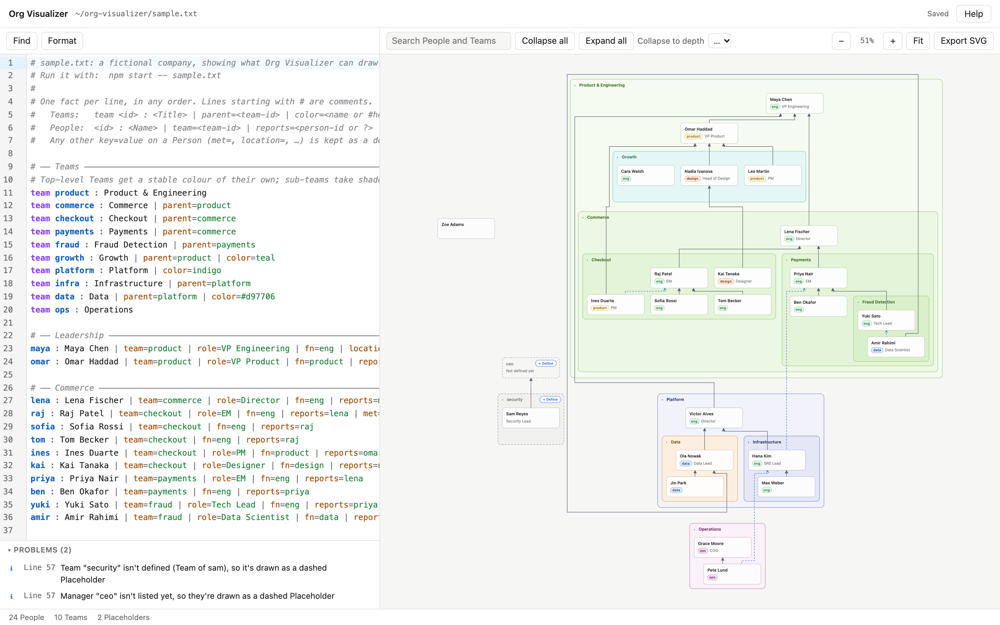
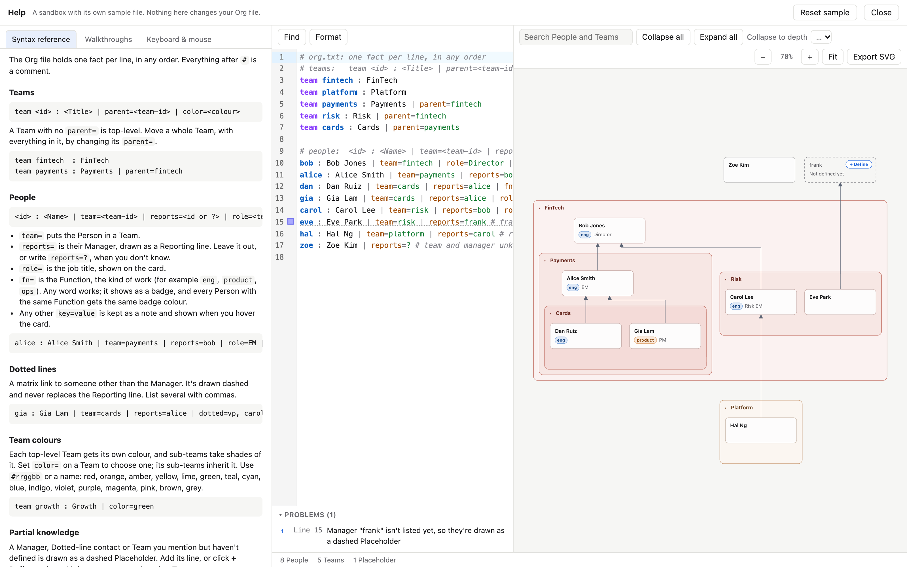

# Org Visualizer

Keep your slice of a large organization as a plain text **Org file**, one fact per line, and see it as a live chart of nested Teams with Reporting lines. Everything runs locally: a small Node server reads and writes one file on your machine, and the chart lives in your browser.



## What it does

- **Nested Teams**: Teams contain People and other Teams, drawn as nested, coloured boxes. Each top-level Team gets its own colour, sub-teams take shades of it, and `color=` overrides it.
- **Reporting lines and Dotted lines**: solid arrows point at each Person's Manager, and dashed lines show matrix relationships. A Manager can sit in any Team, at any depth.
- **Roles and Functions**: job titles on the cards, and colour-coded badges for the kind of work (`eng`, `product`, `design`, …).
- **Partial knowledge**: People and Teams you mention but haven't defined yet are drawn as dashed Placeholders, and `reports=?` marks an unknown Manager. Click **+ Define** to add the missing line.
- **A live editor**: syntax highlighting, inline problems, Find and Replace, and Format. Edits autosave and the chart updates as you type. Changes made outside the app (another editor, `git pull`) show up live.
- **Exploring large charts**: search People and Teams, collapse Teams (one at a time, all, or to a depth), zoom and pan, and export the chart as SVG.
- **Built-in Help**: a syntax reference, keyboard and mouse controls, and step-by-step walkthroughs, all beside a sandbox with its own sample file.

## Get started

You need [Node.js](https://nodejs.org/) **22.12 or newer** (which includes npm) and git.

```sh
git clone https://github.com/ChinthakaJay/org-visualizer.git
cd org-visualizer
npm install
npm start -- sample.txt
```

Then open <http://127.0.0.1:4317> in your browser. `npm start` builds the front end and starts the server. Stop it with Ctrl+C.

[`sample.txt`](sample.txt) is a fictional company that shows off most of the features above. When you're ready to map your own org, point the app at a new file:

```sh
npm start -- path/to/my-org.txt              # a missing file is created from a short template
npm start -- path/to/my-org.txt --port 5000  # use another port
```

A new file opens Help to show you the syntax. The server listens on 127.0.0.1 only and can read and write only the one file you give it. Edits autosave about a second after you stop typing.

> **Tip:** your Org file probably names real colleagues. Keep it outside this repository, or in an `org_files/` folder, which `.gitignore` already excludes.

## The Org file

One fact per line, in any order. Everything after `#` is a comment.

```
team fintech : FinTech
team payments : Payments | parent=fintech | color=purple
bob : Bob Jones | team=fintech | role=Director | fn=eng
alice : Alice Smith | team=payments | reports=bob | dotted=carol | met=2024 offsite
```

| Line | Fields |
| --- | --- |
| `team <id> : <Title>` | `parent=<team-id>` nests it in another Team. `color=` takes a name (red, orange, amber, yellow, lime, green, teal, cyan, blue, indigo, violet, purple, magenta, pink, brown, grey) or `#rrggbb`. |
| `<id> : <Name>` | `team=<team-id>`, `reports=<person-id or ?>`, `role=<job title>`, `fn=<function>`, `dotted=<id>,<id>,…`. Any other `key=value` is kept as a detail and shown when you hover over the card. |

See [`CONTEXT.md`](CONTEXT.md) for exactly what each term means.

## Help and the sandbox

Click **Help** (top right) for the full syntax reference, keyboard and mouse controls, and walkthroughs of everyday changes, such as a new Manager, a Person changing Team or a Team re-org. Help has its own sample file, editor and chart, so you can try anything there without touching your Org file. **Reset sample** puts it back.



In the editor, **Find** (⌘F / Ctrl+F) has Replace in the same panel, and **Format** (⇧⌥F / Shift+Alt+F) tidies the spacing of every line without changing what the file says.

## Develop

```sh
npm test            # Vitest: the Org core (parse, build scene, text edits) and the server's HTTP surface
npm run typecheck
npm run serve -- path/to/org.txt   # API and the last build, without rebuilding
```

`src/core` is the pure Org core (no DOM, no network), `src/server` the local Node server, and `src/web` the React front end. Charts are laid out with [ELK](https://eclipse.dev/elk/) (elkjs) and the editor is [CodeMirror](https://codemirror.net/). The `prototype/` folder is the original throwaway prototype, kept for reference.

See [`CONTEXT.md`](CONTEXT.md) for the domain language and [`docs/adr/`](docs/adr/) for key decisions.

## License

[MIT](LICENSE)
